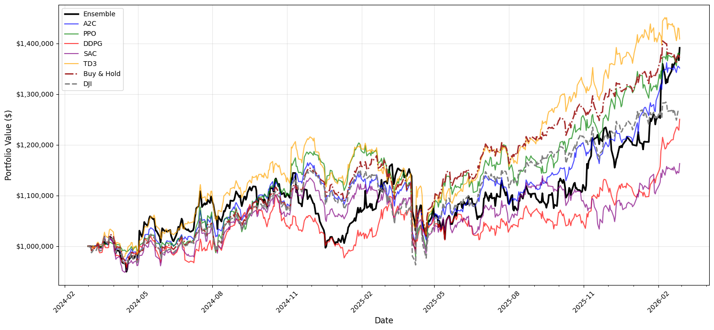

# Dynamic Reinforced Ensemble for Stock Trading

Replication and extension of **DREB**, the dynamic Bayesian-optimised
ensemble of Orra, Serra & Montesi (ICAIF 2024), implemented in the
[FinRL](https://github.com/AI4Finance-Foundation/FinRL) framework.
Built as a group project for the Reinforcement Learning module
(Advances in Machine Learning) of the MSc in Mathematics and Finance at
Imperial College London.

## Method

Five deep RL agents, **A2C, DDPG, TD3, SAC and PPO** (Stable-Baselines3
via FinRL), trade the DJIA constituents simultaneously. Instead of
selecting one agent per quarter by validation Sharpe (the classic FinRL
ensemble of Yang et al., ICAIF 2020), DREB blends all five continuously:

- each agent's weight evolves with a **discounted tracking error** against
  "expert" target returns, so capital shifts toward agents that have
  recently tracked the expert best;
- the weighting hyperparameters (cold-start period, evaluation window,
  discounting and temperature) are tuned by **TPE Bayesian optimisation**
  (Optuna) on validation-period Sharpe;
- splits: train 2014–2022, validation 2022–2024, trade (out-of-sample)
  March 2024 – March 2026.

## Results (out-of-sample, DJIA universe)

| Strategy | Sharpe | Cum. return | Max drawdown | Calmar |
|---|---|---|---|---|
| **DREB ensemble** | **1.04** | 39.1% | **−12.9%** | **1.40** |
| Equal-weight buy & hold | 1.23 | 37.4% | −15.4% | – |
| FinRL dynamic ensemble (Yang et al.) | 0.88 | – | – | – |
| DJIA index | 0.89 | – | – | – |
| Best single agents (A2C, TD3) | 1.17 | – | – | – |

The ensemble improves risk-adjusted performance over the index and over the
classic switch-based FinRL ensemble, with the best Calmar ratio and a
smaller maximum drawdown than buy-and-hold. It does **not** beat
equal-weight buy-and-hold on Sharpe over this strongly trending test window,
which shows how hard that benchmark is for daily-rebalanced strategies in a
trending market.

## Contents

- `dreb_ensemble_stock_trading.ipynb`: the full pipeline covering data download
  (yfinance), feature engineering (technical indicators + turbulence),
  `DRLEnsembleAgentBayesian` (the DREB weighting logic), Optuna search, and
  evaluation against all baselines.
- `img/`: key result figures.

Runs on top of FinRL; developed and executed on Colab (GPU recommended for
the SAC/PPO training loops).

## References

- Orra, A., et al. (2024). *Dynamic Reinforced Ensemble using Bayesian
  Optimization for Stock Trading.* ICAIF 2024.
- Yang, H., Liu, X.-Y., Zhong, S., & Walid, A. (2020). *Deep Reinforcement
  Learning for Automated Stock Trading: An Ensemble Strategy.* ICAIF 2020.
